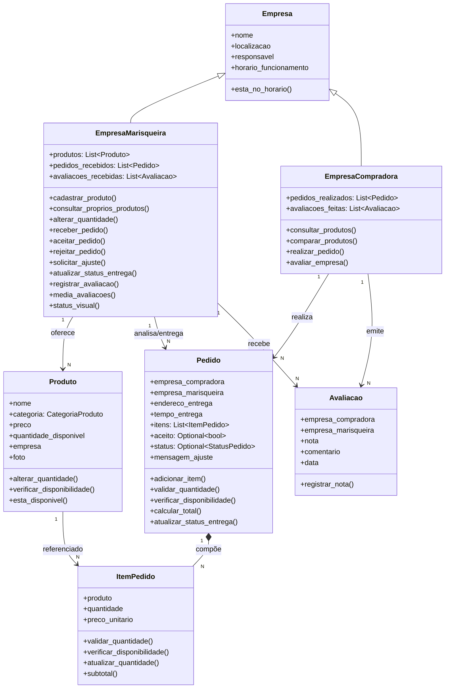

# Modelagem POO — Marisqueiras da Ilha

Documento de modelagem orientada a objetos do sistema **Marisqueiras da Ilha**, alinhado ao PDF de requisitos, critérios e regras de negócio, e à implementação atual (67 testes verdes).

> **Escopo deste documento**: apenas a modelagem orientada a objetos — classes, atributos, métodos, associações, composições, enums, decisões de projeto e rastreabilidade com as regras de negócio. Não trata de persistência, banco de dados, mapeamento objeto-relacional, esquemas, tabelas, chaves ou qualquer forma de armazenamento.

---

## 1. Visão geral

O sistema apoia a comercialização direta de mariscos entre **empresas de marisqueiras** (fornecedoras) e **empresas compradoras**, no modelo **B2B** (RN01). Não há atendimento a consumidor final.

Participam diretamente:

- **EmpresaMarisqueira** — cadastra produtos, recebe e analisa pedidos, realiza a entrega e atualiza o status. Vê apenas os próprios produtos (RN12 / P25).
- **EmpresaCompradora** — consulta produtos de várias marisqueiras, compara, realiza pedidos e avalia marisqueiras após a compra (RN21).

Ambas herdam de uma classe-base **Empresa**, que concentra identidade e horário de funcionamento.

---

## 2. Organização do código

Cada classe do modelo mora em seu próprio módulo Python, e todos são reexportados pelo pacote `marisqueiras`. Essa organização reflete diretamente o diagrama de classes da seção 10 — não há aqui nenhuma noção de armazenamento ou persistência, apenas separação de responsabilidades em arquivos.

```
marisqueiras/
├── __init__.py                # ponto único de importação
├── enums.py                   # CategoriaProduto, StatusPedido, StatusEmpresa
├── excecoes.py                # RegraNegocioError, QuantidadeMinimaError, EstoqueInsuficienteError
├── empresa.py                 # Empresa (classe-base)
├── empresa_marisqueira.py     # EmpresaMarisqueira
├── empresa_compradora.py      # EmpresaCompradora
├── produto.py                 # Produto
├── item_pedido.py             # ItemPedido
├── pedido.py                  # Pedido
└── avaliacao.py               # Avaliacao
```

Os testes da seção 12 ficam em `tests/`, fora do pacote, e existem apenas para verificar a modelagem contra as regras de negócio. Não fazem parte do modelo em si.

---

## 3. Classes, atributos e métodos

### 3.1 Empresa (classe-base)

| Atributo | Tipo | Papel no modelo |
|---|---|---|
| `nome` | str | Identidade da empresa |
| `localizacao` | str | Critério de consulta e ordenação (P21, P22) |
| `responsavel` | str | Uma pessoa por habitação responde pelo cadastro (P12) |
| `horario_funcionamento` | (int, int) | Par (abertura, fechamento) usado pelo indicador visual (P33) |

**Métodos:** `esta_no_horario(hora_atual=None)`.

### 3.2 EmpresaMarisqueira

Herda de `Empresa`. Especializa o comportamento com o ciclo de vida do produto e a análise do pedido.

| Atributo | Tipo | Papel no modelo |
|---|---|---|
| `produtos` | List[Produto] | Produtos oferecidos pela empresa |
| `pedidos_recebidos` | List[Pedido] | Histórico de pedidos que ela recebeu |
| `avaliacoes_recebidas` | List[Avaliacao] | Avaliações que a empresa recebeu |

**Métodos:**

| Método | Responsabilidade |
|---|---|
| `cadastrar_produto(nome, categoria, preco, quantidade, foto=None)` | Cria um `Produto` associado a esta empresa (P15, P16, P18, RN06) |
| `consultar_proprios_produtos()` | Devolve a lista `produtos` desta empresa (RN12 / P25) |
| `alterar_quantidade(produto, nova_qtd)` | Delega ao `Produto` a alteração do estoque (RN08, RN09) |
| `receber_pedido(pedido)` | Registra o `Pedido` em `pedidos_recebidos` |
| `aceitar_pedido(pedido)` | Valida estoque, baixa em cada `ItemPedido` e coloca `Pedido.status = EM_PREPARO` (RN07, RN08, RN18) |
| `rejeitar_pedido(pedido)` | Marca `Pedido.aceito = False` |
| `solicitar_ajuste(pedido, mensagem)` | Grava `Pedido.mensagem_ajuste` |
| `atualizar_status_entrega(pedido, novo_status)` | Permite `EM_PREPARO → EM_CURSO → FINALIZADO` (RN22) |
| `registrar_avaliacao(avaliacao)` | Associa a `Avaliacao` a esta empresa (RN21) |
| `media_avaliacoes()` | Média aritmética das notas recebidas (0.0 se nenhuma) |
| `status_visual(hora_atual=None)` | Retorna `StatusEmpresa` (verde / laranja / vermelho) — P33, RN20 |

### 3.3 EmpresaCompradora

Herda de `Empresa`. Especializa o comportamento com o consumo do catálogo e a avaliação das fornecedoras.

| Atributo | Tipo | Papel no modelo |
|---|---|---|
| `pedidos_realizados` | List[Pedido] | Pedidos que ela criou |
| `avaliacoes_feitas` | List[Avaliacao] | Avaliações que ela emitiu |

**Métodos:**

| Método | Responsabilidade |
|---|---|
| `consultar_produtos(produtos, nome=None, categoria=None, localizacao=None, empresa_marisqueira=None, avaliacao_minima=None, ordenar_por=None)` | Filtros e ordenação sobre uma lista de produtos (RN10, RN11 / P9, P21, P22) |
| `comparar_produtos(produto_a, produto_b)` | Devolve um dicionário comparando dois produtos, possivelmente de empresas diferentes (RN12 / P26) |
| `realizar_pedido(empresa_marisqueira, endereco_entrega, tempo_entrega, itens)` | Cria um `Pedido` já validado (mesma empresa, mínimo 25 kg por item, estoque) (RN13, RN14, RN15, RN18) |
| `avaliar_empresa(empresa_marisqueira, nota, comentario=None)` | Cria uma `Avaliacao` somente se houver pedido aceito entre as duas empresas (RN21, P23, P24) |

### 3.4 Produto

| Atributo | Tipo | Papel no modelo |
|---|---|---|
| `nome` | str | Nome do produto |
| `categoria` | `CategoriaProduto` | `FRESCO` ou `CONGELADO` (RN06) |
| `preco` | float | Preço por kg (RN04, RN07) |
| `quantidade_disponivel` | int | Estoque em kg (RN04) |
| `empresa` | `EmpresaMarisqueira` | Associação com a empresa dona |
| `foto` | Optional[str] | Único campo opcional (P15) |

**Métodos:** `alterar_quantidade(nova_qtd)`, `verificar_disponibilidade(qtd)`, `esta_disponivel()`.

> **Nota sobre RN05:** o mínimo de 25 kg é regra de **venda**, não de cadastro. `Produto` aceita qualquer quantidade ≥ 0; a validação de 25 kg acontece no `ItemPedido`.

### 3.5 ItemPedido

Classe associativa que representa a participação de um `Produto` em um `Pedido`.

| Atributo | Tipo | Papel no modelo |
|---|---|---|
| `produto` | `Produto` | Associação com o produto comprado |
| `quantidade` | int | Quantidade em kg |
| `preco_unitario` | float | Cópia do preço no instante da compra (RN07) |

**Métodos:** `validar_quantidade()`, `verificar_disponibilidade()`, `atualizar_quantidade(nova_qtd)`, `subtotal()`.

### 3.6 Pedido

| Atributo | Tipo | Papel no modelo |
|---|---|---|
| `empresa_compradora` | `EmpresaCompradora` | Associação com quem realizou o pedido (RN13) |
| `empresa_marisqueira` | `EmpresaMarisqueira` | Associação com a fornecedora (RN14) |
| `endereco_entrega` | str | Obrigatório (RN13) |
| `tempo_entrega` | str | Obrigatório (RN13) |
| `itens` | List[ItemPedido] | Composição (P28) |
| `aceito` | Optional[bool] | `None` = pendente, `True` = aceito, `False` = rejeitado |
| `status` | Optional[StatusPedido] | `EM_PREPARO`, `EM_CURSO` ou `FINALIZADO` |
| `mensagem_ajuste` | Optional[str] | Registro de solicitação de ajuste |
| `criado_em` | datetime | Momento de criação |

**Métodos:** `adicionar_item(produto, quantidade)`, `validar_quantidade()`, `verificar_disponibilidade()`, `calcular_total()`, `atualizar_status_entrega(novo_status)`.

### 3.7 Avaliacao

| Atributo | Tipo | Papel no modelo |
|---|---|---|
| `empresa_compradora` | `EmpresaCompradora` | Associação com quem avaliou (RN21) |
| `empresa_marisqueira` | `EmpresaMarisqueira` | Associação com quem foi avaliada (RN21) |
| `nota` | int | 1 a 5 (P24) |
| `comentario` | Optional[str] | Comentário livre |
| `data` | datetime | Momento da avaliação |

**Métodos:** `registrar_nota(nota)`.

> **Validação no construtor:** exige que exista um pedido aceito entre as duas empresas. Sem compra, `RegraNegocioError`.

---

## 4. Enums

```python
class CategoriaProduto(Enum):
    FRESCO = "fresco"
    CONGELADO = "congelado"

class StatusPedido(Enum):
    EM_PREPARO = "em_preparo"
    EM_CURSO = "em_curso"
    FINALIZADO = "finalizado"

class StatusEmpresa(Enum):
    DISPONIVEL = "verde"
    ESTOQUE_BAIXO = "laranja"
    FORA_DO_HORARIO = "vermelho"
```

---

## 5. Associações e composições

Tabela puramente UML — descreve como os objetos se **relacionam em memória**, no modelo de classes.

| Origem | Destino | Tipo | Leitura |
|---|---|---|---|
| EmpresaMarisqueira | Produto | Associação unidirecional (1 : N) | Uma marisqueira oferece vários produtos; cada produto pertence a uma marisqueira |
| EmpresaMarisqueira | Pedido | Associação unidirecional (1 : N) | Uma marisqueira recebe vários pedidos; cada pedido é destinado a uma marisqueira |
| EmpresaCompradora | Pedido | Associação unidirecional (1 : N) | Uma compradora realiza vários pedidos; cada pedido pertence a uma compradora |
| EmpresaCompradora | Avaliacao | Associação unidirecional (1 : N) | Uma compradora emite várias avaliações; cada avaliação tem um autor |
| EmpresaMarisqueira | Avaliacao | Associação unidirecional (1 : N) | Uma marisqueira recebe várias avaliações; cada avaliação tem um destinatário |
| Pedido | ItemPedido | **Composição** (1 : N) | Um pedido é composto por vários itens; um item não existe sem o pedido |
| Produto | ItemPedido | Associação (1 : N) | Um produto pode aparecer em vários itens; cada item aponta para um produto |

Observações:

- **Herança**: `EmpresaMarisqueira` e `EmpresaCompradora` herdam de `Empresa`.
- **Composição** em `Pedido → ItemPedido`: o ciclo de vida do item é controlado pelo pedido (o item nasce no `adicionar_item` e não é referenciado fora do pedido).
- Todas as demais associações são **unidirecionais**, navegáveis a partir da origem.

---

## 6. Restrições implementadas

| # | Restrição | Onde é imposta |
|---|---|---|
| R1 | Mínimo de 25 kg por produto **na venda** (não no cadastro) | `ItemPedido.validar_quantidade` (RN05, RN15) |
| R2 | Quantidade solicitada ≤ disponível | `ItemPedido.verificar_disponibilidade` (RN18 / P34) |
| R3 | Um pedido só reúne produtos da mesma marisqueira | `Pedido.adicionar_item` (RN14 / P29) |
| R4 | Sem valor financeiro mínimo | (nenhuma validação de R$ mínimo) (RN16 / P31) |
| R5 | Estoque zero → produto permanece cadastrado como indisponível | `Produto.esta_disponivel` (RN09 / P20) |
| R6 | Forma de pagamento fora do escopo | (nenhum atributo) (P27) |
| R7 | Entrega pela própria marisqueira, sem rastreamento em tempo real | `EmpresaMarisqueira.atualizar_status_entrega` (RN22) |
| R8 | Preço fixo durante a venda | `ItemPedido.preco_unitario` (RN07) |
| R9 | Fresco e congelado são produtos distintos | `EmpresaMarisqueira.cadastrar_produto` (RN06 / P18) |
| R10 | Avaliação só após compra aceita, escala 1–5 | `Avaliacao.__init__` + `registrar_nota` (RN21 / P23, P24) |

---

## 7. Estados de `Pedido`

O `Pedido` tem **dois atributos independentes**:

**Análise (`aceito`):**

```
None (pendente) ──aceitar_pedido──▶ True  (aceito)
                └─rejeitar_pedido─▶ False (rejeitado)
```

**Entrega (`status`):**

```
None ──aceitar_pedido──▶ EM_PREPARO ──▶ EM_CURSO ──▶ FINALIZADO
```

- `solicitar_ajuste` **não muda** nenhum dos dois — apenas grava `mensagem_ajuste`.
- `atualizar_status_entrega` só é permitido se `aceito is True`.
- Não é possível voltar estados.

---

## 8. Decisões de modelagem

1. **`Pedido` guarda associações com as duas empresas** — `empresa_compradora` e `empresa_marisqueira` são atributos do construtor, atendendo RN13 e RN14.
2. **`Avaliacao` guarda associações com as duas empresas** — `empresa_compradora` e `empresa_marisqueira`, atendendo RN21 / P23.
3. **Apenas 3 estados de entrega** — conforme o PDF (`EM_PREPARO`, `EM_CURSO`, `FINALIZADO`). O `aceite` é um booleano à parte, não um estado do enum.
4. **`realizar_pedido` recebe uma lista de `(produto, quantidade)`** — já valida tudo de uma vez (mesma empresa, mínimo 25 kg por item, estoque), e só então instancia o `Pedido`. Sem isso, um "pedido inválido" poderia ser construído em etapas.
5. **`consultar_produtos` recebe a lista de produtos por parâmetro** — não existe repositório nem coleção global. Quem quiser consultar passa a lista (por exemplo, `marisqueira.consultar_proprios_produtos()` ou a soma de várias).
6. **RN05 é regra de venda, não de cadastro** — `Produto` aceita qualquer quantidade ≥ 0; o mínimo de 25 kg só é validado em `ItemPedido`.
7. **RN20 implementada** — `status_visual` retorna verde / laranja / vermelho com base no horário de funcionamento e no estoque.
8. **RN07 garantida por cópia do preço** — `ItemPedido.preco_unitario` guarda o preço no momento da compra; alterações posteriores em `Produto.preco` não afetam o item.
9. **RN23 garantida por omissão** — o custo da entrega está embutido em `Produto.preco`; não há atributo de frete separado.

---

## 9. Rastreabilidade RN → método → teste

| RN | Método principal | Teste(s) |
|---|---|---|
| RN01 | herança de `Empresa` | (conceitual) |
| RN02 | `Empresa.responsavel` | `test_rn02_uma_pessoa_por_habitacao` |
| RN03 | `EmpresaMarisqueira` autônoma | (conceitual) |
| RN04 | `Produto.quantidade_disponivel` (kg) | `test_p15_foto_opcional` |
| RN05 | `ItemPedido.validar_quantidade` | `test_minimo_25_kg`, `test_exatamente_25_kg_ok`, `test_cadastro_com_menos_de_25_kg_permitido` |
| RN06 | `cadastrar_produto` | `test_rn06_fresco_congelado_distintos`, `test_rn06_duplicado_mesma_categoria` |
| RN07 | `ItemPedido.preco_unitario` | `test_preco_congelado_na_compra` |
| RN08 | `alterar_quantidade` | `test_alterar_estoque`, `test_alterar_quantidade_revalida_minimo` |
| RN09 | `esta_disponivel` / `alterar_quantidade` | `test_zerar_estoque_produto_permanece`, `test_cadastro_com_zero_kg_permitido` |
| RN10 | `consultar_produtos` | `test_filtro_por_nome`, `test_filtro_por_categoria`, `test_filtro_por_localizacao`, `test_filtro_por_empresa` |
| RN11 | `consultar_produtos(ordenar_por=...)` | `test_ordenar_menor_preco`, `test_ordenar_maior_preco`, `test_ordenacao_invalida` |
| RN12 | `consultar_proprios_produtos`, `comparar_produtos` | `test_p25_marisqueira_ve_somente_proprios`, `test_comparar_entre_empresas` |
| RN13 | `Pedido.__init__` + `realizar_pedido` | `test_dados_obrigatorios`, `test_pedido_sem_itens_bloqueado` |
| RN14 | `Pedido.adicionar_item` | `test_rn14_produto_de_outra_empresa_bloqueado` |
| RN15 | `ItemPedido.validar_quantidade` | `test_minimo_25_kg`, `test_rn15_minimo_por_produto` |
| RN16 | (nenhuma validação) | `test_rn16_sem_minimo_financeiro` |
| RN17 | limitado só pelo estoque | `test_rn17_sem_maximo_fixo` |
| RN18 | `verificar_disponibilidade` | `test_estoque_insuficiente`, `test_rn18_p34_quantidade_maior_que_estoque` |
| RN19 | produto continua na lista | `test_cadastro_com_zero_kg_permitido`, `test_sem_produtos_laranja` |
| RN20 | `status_visual` | `test_fora_do_horario_vermelho`, `test_disponivel_verde`, `test_estoque_baixo_laranja`, `test_sem_produtos_laranja` |
| RN21 | `avaliar_empresa` + `Avaliacao.__init__` | `test_avaliar_sem_compra_bloqueado`, `test_avaliar_com_pedido_pendente_bloqueado`, `test_avaliar_com_pedido_rejeitado_bloqueado`, `test_avaliar_apos_compra_aceita` |
| RN22 | `atualizar_status_entrega` | `test_fluxo_valido`, `test_transicao_invalida`, `test_nao_avanca_apos_finalizado`, `test_sem_aceite_nao_pode_atualizar`, `test_status_invalido` |
| RN23 | (embutido em `Produto.preco`) | `test_calcular_total` |

Perguntas P relevantes: P12 (responsável), P15 (foto opcional), P16 (kg), P18 (fresco ≠ congelado), P19–P20 (estoque), P21–P22 (filtros/ordenação), P23–P24 (avaliação 1–5), P25–P26 (visibilidade/comparação), P27–P32 (pedido), P33 (indicador visual), P34 (bloqueio por indisponibilidade).

---

## 10. Diagrama de classes (UML)



---

## 11. Glossário de RNs

| RN | Descrição |
|---|---|
| RN01 | B2B; sem consumidor final |
| RN02 | 1 habitação = 1 empresa |
| RN03 | Marisqueira pode atuar individualmente |
| RN04 | Venda por kg |
| RN05 | Mínimo 25 kg por produto |
| RN06 | Fresco e congelado são produtos diferentes |
| RN07 | Preço por produto e empresa; fixo durante a venda |
| RN08 | Quantidade disponível pode ser alterada |
| RN09 | Estoque zero → produto permanece indisponível |
| RN10 | Busca por nome, categoria, localização, empresa, avaliação |
| RN11 | Ordenação por preço, avaliação, proximidade |
| RN12 | Marisqueira vê só os próprios produtos; comprador compara |
| RN13 | Campos obrigatórios do pedido |
| RN14 | Um pedido = uma marisqueira |
| RN15 | 25 kg por item |
| RN16 | Sem valor financeiro mínimo |
| RN17 | Sem quantidade máxima fixa |
| RN18 | Bloqueia quantidade acima do disponível |
| RN19 | Empresa permanece cadastrada sem estoque |
| RN20 | Indicador visual (verde/laranja/vermelho) |
| RN21 | Avaliação 1 a 5 estrelas após compra |
| RN22 | Entrega pela marisqueira; sem rastreamento em tempo real |
| RN23 | Custo da entrega embutido no preço |

---

## 12. Suíte de testes

**67 testes · todos verdes.**

```bash
python -m pip install -r requirements.txt
python -m pytest tests/ -v
```

| Arquivo | Testes | Cobre |
|---|---|---|
| `tests/test_produto.py` | 10 | RN05, RN06, RN08, RN09, P15, P16, P18, P19, P20 |
| `tests/test_empresa_marisqueira.py` | 16 | RN07, RN08, RN20, RN22, P7, P33 |
| `tests/test_empresa_compradora.py` | 16 | RN10–RN18, P9, P21, P22, P25–P34 |
| `tests/test_pedido.py` | 12 | RN05, RN07, RN13, RN14, RN15, RN17, RN18, RN22 |
| `tests/test_avaliacao.py` | 11 | RN21, P23, P24 |
| `tests/test_fluxo_pedido.py` | 2 | P7 (integração ponta a ponta) |
| **Total** | **67** | |

---

## 13. Decisões confirmadas

1. **`Pedido` guarda associações com as duas empresas** — confirmado.
2. **`Avaliacao` guarda associações com as duas empresas** — confirmado.
3. **`aceitar_pedido()` e `rejeitar_pedido()` ficam em `EmpresaMarisqueira`** — confirmado.
4. **Apenas 3 estados de entrega** — confirmado (`EM_PREPARO`, `EM_CURSO`, `FINALIZADO`). O aceite é um booleano, não um estado.
5. **`solicitar_ajuste()` existe** — está na lista oficial de métodos do PDF e foi implementado.

---