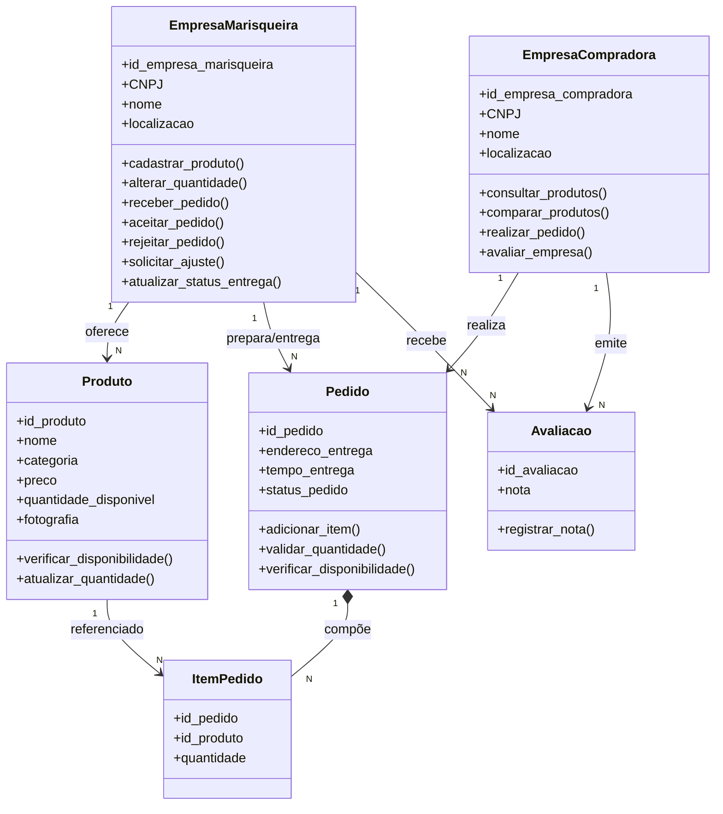

# Modelagem POO — Marisqueiras da Ilha

Documento de modelagem orientada a objetos do sistema **Marisqueiras da Ilha**, conforme PDF de classes, atributos e restrições da disciplina.

---

## 1. Visão geral

O sistema apoia a comercialização direta de mariscos entre **empresas de marisqueiras** (fornecedoras) e **empresas compradoras**, no modelo **B2B**. Não há atendimento a consumidor final.

Participam diretamente:

- **EmpresaMarisqueira** — cadastra produtos, recebe e analisa pedidos, realiza a entrega.
- **EmpresaCompradora** — consulta produtos, realiza pedidos, avalia marisqueiras.

---

## 2. Classes, atributos e métodos

### 2.1 EmpresaMarisqueira

| Atributo | Observação |
|---|---|
| `id_empresa_marisqueira` | Identificador |
| `CNPJ` | Cadastro |
| `nome` | Nome da empresa |
| `localizacao` | Critério de consulta |

**Métodos:**

| Método | Responsabilidade |
|---|---|
| `cadastrar_produto(id_produto, nome, categoria, preco, quantidade_disponivel, fotografia=None)` | Cria produto (RN05) |
| `alterar_quantidade(produto, quantidade)` | Altera estoque (RN08) |
| `receber_pedido(pedido)` | Marca pedido como `recebido` |
| `aceitar_pedido(pedido)` | Move para `em preparo` |
| `rejeitar_pedido(pedido)` | Move para `rejeitado` ⚠️ |
| `solicitar_ajuste(pedido)` | Move para `ajuste solicitado` ⚠️ |
| `atualizar_status_entrega(pedido, status)` | Move para `em curso` / `finalizado` (RN22) |

### 2.2 EmpresaCompradora

| Atributo | Observação |
|---|---|
| `id_empresa_compradora` | Identificador |
| `CNPJ` | Cadastro |
| `nome` | Nome da empresa |
| `localizacao` | Critério de consulta |

**Métodos:**

| Método | Responsabilidade |
|---|---|
| `consultar_produtos(nome, categoria, localizacao, empresa, ordenar_por)` | Filtros e ordenação (RN10, RN11) |
| `comparar_produtos(produtos)` | Comparação (P26) |
| `realizar_pedido(id_pedido, endereco_entrega, tempo_entrega)` | Cria pedido (RN13) |
| `avaliar_empresa(id_avaliacao, empresa, nota)` | Cria avaliação (RN21) |

### 2.3 Produto

| Atributo | Observação |
|---|---|
| `id_produto` | Identificador |
| `nome` | Nome |
| `categoria` | `fresco` ou `congelado` (RN06) |
| `preco` | Definido por produto e empresa (RN07) |
| `quantidade_disponivel` | Em kg — semântica de venda (RN04) |
| `fotografia` | Opcional (P15) |

**Métodos:** `verificar_disponibilidade(quantidade=None)`, `atualizar_quantidade(quantidade)`.

### 2.4 Pedido

| Atributo | Observação |
|---|---|
| `id_pedido` | Identificador |
| `endereco_entrega` | Endereço |
| `tempo_entrega` | Tempo estimado |
| `status_pedido` | Estado atual |

**Métodos:** `adicionar_item(produto, quantidade)`, `validar_quantidade(item)`, `verificar_disponibilidade()`.

### 2.5 ItemPedido

| Atributo | Observação |
|---|---|
| `id_pedido` | FK para Pedido |
| `id_produto` | FK para Produto |
| `quantidade` | Em kg |

*(Sem métodos próprios — entidade associativa.)*

### 2.6 Avaliacao

| Atributo | Observação |
|---|---|
| `id_avaliacao` | Identificador |
| `nota` | 1 a 5 estrelas (RN21) |

**Métodos:** `registrar_nota(nota)`.

---

## 3. Relações

| Origem | Multiplicidade | Destino | Tipo |
|---|---|---|---|
| EmpresaMarisqueira | 1 → N | Produto | Associação |
| EmpresaMarisqueira | 1 → N | Pedido | Associação (prepara/entrega) |
| EmpresaCompradora | 1 → N | Pedido | Associação (realiza) |
| EmpresaCompradora | 1 → N | Avaliacao | Associação (emite) |
| EmpresaMarisqueira | 1 → N | Avaliacao | Associação (recebe) |
| Pedido | 1 → N | ItemPedido | Composição |
| Produto | 1 → N | ItemPedido | Associação (referenciado) |

---

## 4. Restrições (do PDF)

| # | Restrição | Método que impõe |
|---|---|---|
| R1 | Quantidade mínima de 25 kg por produto | `cadastrar_produto`, `validar_quantidade` |
| R2 | Quantidade solicitada ≤ disponível | `adicionar_item` |
| R3 | Um pedido só reúne produtos da mesma marisqueira | `adicionar_item` |
| R4 | Não existe valor financeiro mínimo | (nenhum) |
| R5 | Estoque zero → produto permanece como indisponível | `verificar_disponibilidade` |
| R6 | Forma de pagamento fora do escopo | (nenhum) |
| R7 | Entrega pela própria marisqueira, sem rastreamento em tempo real | `atualizar_status_entrega` |

---

## 5. Estados de `status_pedido`

```
pendente → recebido → em preparo → em curso → finalizado
                ↓
          rejeitado | ajuste solicitado  ⚠️
```

Os estados **`em preparo`, `em curso`, `finalizado`** vêm diretamente do PDF.
Os estados **`pendente`, `recebido`, `rejeitado`, `ajuste solicitado`** são **decisões de modelagem** ⚠️ para dar suporte aos métodos `receber_pedido`, `rejeitar_pedido` e `solicitar_ajuste`.

---

## 6. Decisões de modelagem ⚠️

Pontos que a modelagem simplificada deixou em aberto e que foram resolvidos:

1. **Pedido ↔ EmpresaCompradora** — `Pedido` recebe o comprador como parâmetro no construtor e guarda referência (`self.comprador`). A associação não aparece como atributo na tabela do PDF, mas é necessária para RN13.
2. **Avaliacao ↔ EmpresaMarisqueira** — `avaliar_empresa` recebe `empresa` como parâmetro e a `Avaliacao` guarda referência. Necessário para RN21.
3. **Estados extras de `status_pedido`** — descritos na seção 5.
4. **Registro global de produtos** — para que `EmpresaCompradora` consulte produtos de várias marisqueiras (RN12) sem um repositório explícito, foi usado um dicionário `_REGISTRO_PRODUTOS` no módulo `marisqueiras.py`.
5. **RN07 (preço não alterável durante venda)** — como não há método de alteração de preço na lista oficial, a RN07 é satisfeita por omissão: não existe caminho no código para alterar preço de um produto que já esteja em um pedido.
6. **RN04 (venda por kg)** — não há atributo `unidade`; a unidade é semântica implícita da `quantidade_disponivel`.
7. **RN20 (indicador visual verde/laranja/vermelho)** — fora do escopo desta modelagem. Exigiria atributos como horário de funcionamento ou limite de estoque baixo, que não constam no PDF definitivo.

---

## 7. Rastreabilidade RN → método → teste

| RN | Método | Teste |
|---|---|---|
| RN04 | `Produto` (semântica kg) | `test_p15_cadastro_completo_exceto_fotografia` |
| RN05 | `cadastrar_produto`, `validar_quantidade` | `test_rn05_minimo_25kg_cadastro`, `test_rn15_minimo_25kg_por_item` |
| RN06 | `cadastrar_produto` | `test_rn06_fresco_e_congelado_diferentes` |
| RN07 | (por omissão) | `test_rn07_preco_nao_alteravel_durante_venda` |
| RN08 | `alterar_quantidade`, `atualizar_quantidade` | `test_rn08_alterar_quantidade`, `test_atualizar_quantidade_direto_no_produto` |
| RN09 | `atualizar_quantidade`, `verificar_disponibilidade` | `test_rn09_produto_zerado_permanece` |
| RN10 | `consultar_produtos` | `test_rn10_filtro_por_nome`, `test_rn10_filtro_por_categoria`, `test_rn10_filtro_por_localizacao`, `test_rn10_filtro_por_empresa` |
| RN11 | `consultar_produtos(ordenar_por=...)` | `test_rn11_ordenar_por_menor_e_maior_preco` |
| RN12 | `consultar_produtos` + `produtos` | `test_p25_marisqueira_ve_apenas_proprios_produtos`, `test_rn12_comprador_ve_multiplas_empresas` |
| RN13 | `realizar_pedido` | `test_id_pedido_registrado`, `test_pagamento_fora_do_escopo` |
| RN14 | `adicionar_item` | `test_nao_misturar_marisqueiras`, `test_pedido_varios_produtos_mesma_empresa` |
| RN15 | `validar_quantidade` | `test_rn15_minimo_25kg_por_item`, `test_validar_quantidade_exata`, `test_validar_quantidade_abaixo` |
| RN16 | `adicionar_item` | `test_rn16_sem_valor_minimo_financeiro` |
| RN17 | `adicionar_item` | `test_rn17_sem_quantidade_maxima_fixa` |
| RN18 | `adicionar_item`, `verificar_disponibilidade` | `test_rn18_bloqueia_acima_do_disponivel`, `test_verificar_disponibilidade_insuficiente` |
| RN19 | `cadastrar_produto` | `test_rn19_empresa_sem_estoque_permanece_cadastrada` |
| RN21 | `avaliar_empresa`, `registrar_nota` | testes de avaliação |
| RN22 | `atualizar_status_entrega` | `test_fluxo_completo`, `test_atualizar_status_entrega_em_curso`, `test_atualizar_status_entrega_finalizado` |
| RN23 | (por omissão) | `test_sem_custo_de_entrega_separado` |

RN01, RN02, RN03 e RN20 não têm método correspondente — são restrições organizacionais / de apresentação fora do escopo da modelagem simplificada.

---

## 8. Diagrama de classes (Mermaid)



---

## 9. Glossário de RNs (referência rápida)

| RN | Descrição |
|---|---|
| RN01 | B2B; sem consumidor final |
| RN02 | 1 habitação = 1 empresa |
| RN03 | Marisqueira pode atuar individualmente |
| RN04 | Venda por kg |
| RN05 | Mínimo 25 kg por produto |
| RN06 | Fresco e congelado são produtos diferentes |
| RN07 | Preço por produto e empresa; fixo durante a venda |
| RN08 | Quantidade disponível pode ser alterada |
| RN09 | Estoque zero → produto permanece indisponível |
| RN10 | Busca por nome, categoria, localização, empresa, avaliação |
| RN11 | Ordenação por preço, avaliação, proximidade |
| RN12 | Marisqueira vê só os próprios produtos; comprador compara |
| RN13 | Campos obrigatórios do pedido |
| RN14 | Um pedido = uma marisqueira |
| RN15 | 25 kg por item |
| RN16 | Sem valor financeiro mínimo |
| RN17 | Sem quantidade máxima fixa |
| RN18 | Bloqueia quantidade acima do disponível |
| RN19 | Empresa permanece cadastrada sem estoque |
| RN20 | Indicador visual (verde/laranja/vermelho) |
| RN21 | Avaliação 1 a 5 estrelas |
| RN22 | Entrega pela marisqueira; sem rastreamento em tempo real |
| RN23 | Custo da entrega embutido no preço |

---

## 10. Suíte de testes

**62 testes · todos verdes.**

Para rodar:

```bash
python -m pip install -r requirements.txt
python -m pytest -v
```

| Arquivo | Testes |
|---|---|
| `tests/test_produto.py` | 10 |
| `tests/test_empresa_marisqueira.py` | 4 |
| `tests/test_empresa_compradora.py` | 9 |
| `tests/test_pedido.py` | 15 |
| `tests/test_fluxo_pedido.py` | 9 |
| `tests/test_avaliacao.py` | 15 |

---

## 11. Decisões em aberto (aguardando a docente)

1. **`Pedido` guarda comprador como atributo?** — hoje guarda referência via construtor.
2. **`Avaliacao` guarda marisqueira como atributo?** — hoje guarda referência via construtor.
3. **Valores oficiais de `status_pedido` para `rejeitado` e `ajuste solicitado`?** — hoje são decisão de modelagem.

Assim que a docente se manifestar, ajustar:

- `marisqueiras.py` (construtor/atributo)
- testes correspondentes
- seções 2 e 5 deste documento